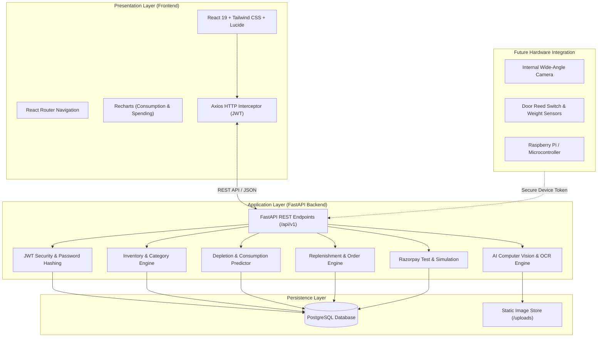

# SmartFridge AI – Intelligent Refrigerator Monitoring & Replenishment System

## Project Overview
SmartFridge AI transforms traditional refrigeration into an autonomous household manager.
It monitors stored products across 6 major categories (Groceries, Beverages, Medicines, Skincare, Prepared Foods, Other Items), learns consumption patterns, predicts depletion dates, monitors expiry and storage parameters, and executes automated replenishment orders with authorized payment gateways.

---

## 🏛️ System Architecture



---

## 📁 Project Directory Structure

```
smartfridge-ai/
├── backend/
│   ├── app/
│   │   ├── __init__.py
│   │   ├── main.py                     # FastAPI entrypoint, middleware, routes
│   │   ├── api/
│   │   │   └── v1/
│   │   │       ├── __init__.py
│   │   │       ├── router.py           # Unified v1 router
│   │   │       └── endpoints/
│   │   │           └── health.py       # Health check & system diagnostics
│   │   ├── core/
│   │   │   ├── __init__.py
│   │   │   └── config.py               # Pydantic v2 environment settings
│   │   ├── db/                         # Database session, base model & engine
│   │   ├── models/                     # SQLAlchemy ORM models
│   │   ├── schemas/                    # Pydantic validation schemas
│   │   └── services/
│   │       ├── ai/                     # CV detection & recognition services
│   │       ├── payments/               # Payment gateway & simulation
│   │       └── shopping/               # Catalog & replenishment services
│   ├── uploads/                        # Refrigerator photo uploads & assets
│   ├── venv/                           # Python 3.11 virtual environment
│   ├── .env.example                    # Environment variable template
│   ├── .env                            # Active development environment variables
│   └── requirements.txt                # Python backend dependencies
├── frontend/
│   ├── src/
│   │   ├── assets/
│   │   ├── components/
│   │   │   └── common/                 # Reusable UI cards, tables, modals
│   │   ├── context/                    # Auth and Fridge state contexts
│   │   ├── pages/                      # Page components (Dashboard, Inventory, etc.)
│   │   ├── services/
│   │   │   └── api.js                  # Axios client with JWT interceptor
│   │   ├── utils/                      # Formatting & calculations
│   │   ├── App.jsx                     # Root application component
│   │   ├── index.css                   # Tailwind v4 directives & custom theme
│   │   └── main.jsx                    # Vite React entry point
│   ├── package.json                    # Frontend dependencies & scripts
│   └── vite.config.js                  # Vite configuration with Tailwind plugin
└── README.md
```

---

## 🚀 Getting Started (Phase 1 Testing)

### 1. Backend Server
Open a Windows PowerShell terminal in the project root:
```powershell
cd backend
.\venv\Scripts\Activate.ps1
uvicorn app.main:app --reload --port 8000
```
- API Base: `http://localhost:8000`
- Swagger Interactive Documentation: `http://localhost:8000/api/v1/docs`
- Health Endpoint: `http://localhost:8000/api/v1/health`

### 2. Frontend Development Server
Open a second Windows PowerShell terminal in the project root:
```powershell
cd frontend
npm run dev
```
- Frontend UI: `http://localhost:5173`
- The UI will immediately query the backend health check endpoint and display live operational metrics.
